# cover-studio

**Covers, done.** Presentation covers and device mockups for designers who post their work. An open-source CLI that captures your live design and renders it in 18 tested patterns, at every size a channel needs.

[Website](https://cover-studio-cli.vercel.app) · [Patterns](docs/patterns.md) · [Config reference](docs/config.md) · [MIT licence](LICENSE)

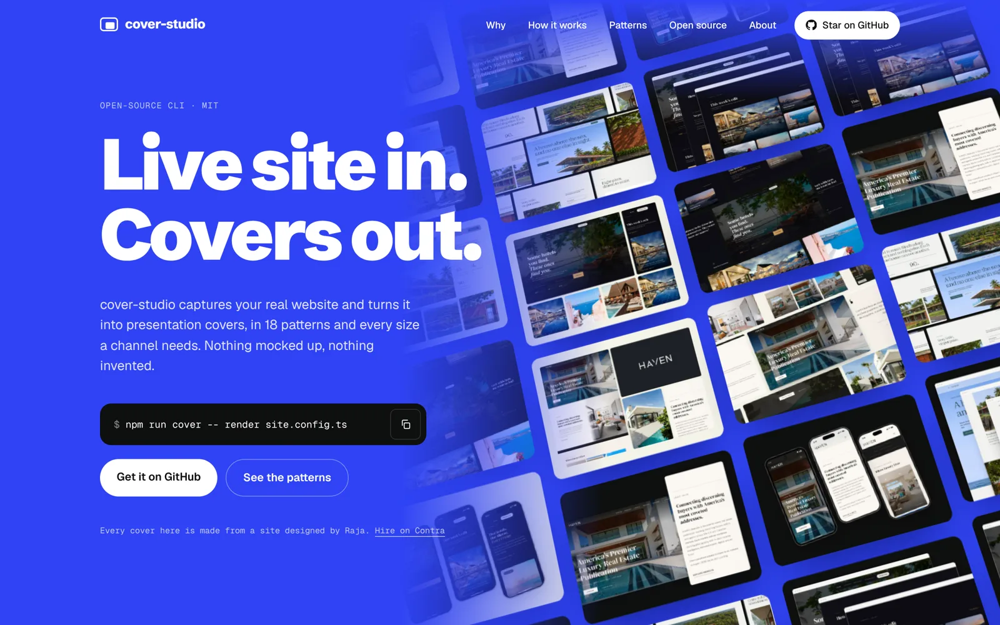

## Who it's for

Designers and creators who share their work on Dribbble, Contra, Behance, X, in portfolios and in pitches. Every shot you post needs a cover and mockups:

- Mockups take hours: frames, devices, backgrounds and three sizes, rebuilt by hand for every shot.
- Mockup kits look like everyone else's: the same stock devices and scenes, filled with placeholder content instead of your work.
- AI tools burn tokens and drift: every revision is another prompt, no two results match, and details get invented.

cover-studio makes the covers and mockups from your real work. Point it at your live design and it keeps the real screens, puts them in real device frames and lays them out in patterns measured from strong reference covers. No design session, no prompts, the same quality every time.

## What it saves

| | |
|---|---|
| **0 AI tokens per cover** | It runs on your machine with no model in the loop. Nothing to prompt, nothing to prompt again when a round misses. |
| **About 1 second per cover** | After a one-time capture of one to four minutes, every pattern and size renders in about a second (measured). |
| **18 tested patterns** | Each measured from a reference cover and checked on real sites: no empty space, no cut text, no cropped headline. |
| **Consistent** | The same layouts and proportions on every project, so your posts read as one professional series. |
| **Free** | MIT licensed. No account, no API key, no subscription, no watermark. |

## What it makes

| | | |
|---|---|---|
| 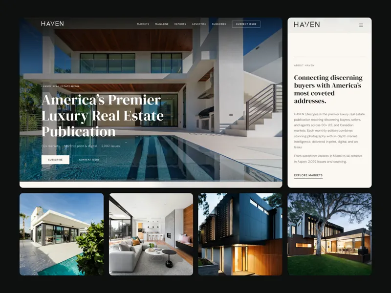 | 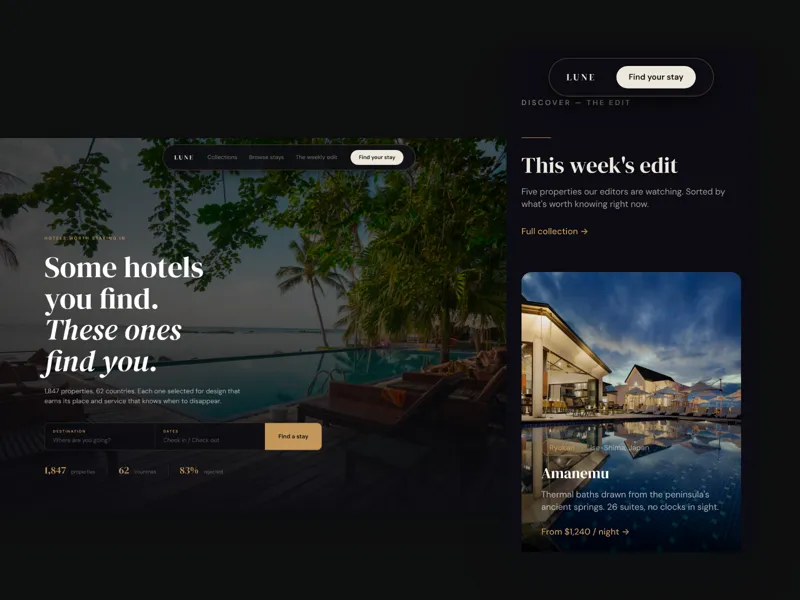 | 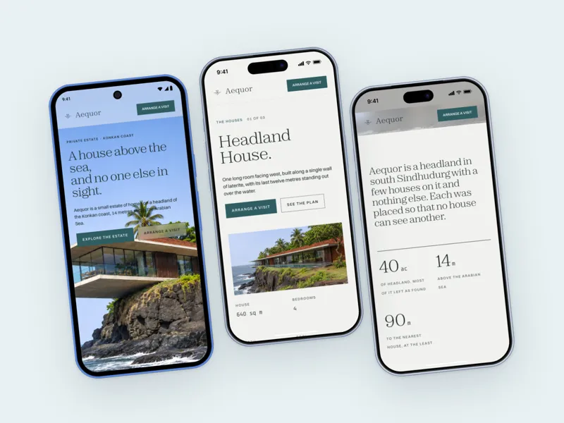 |
| `bento` | `floating` | `phone-trio` |
| 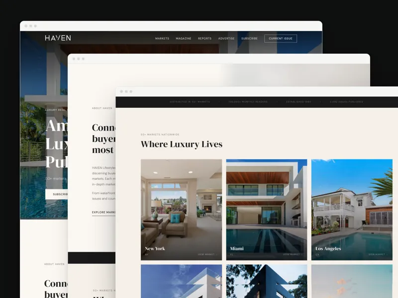 | 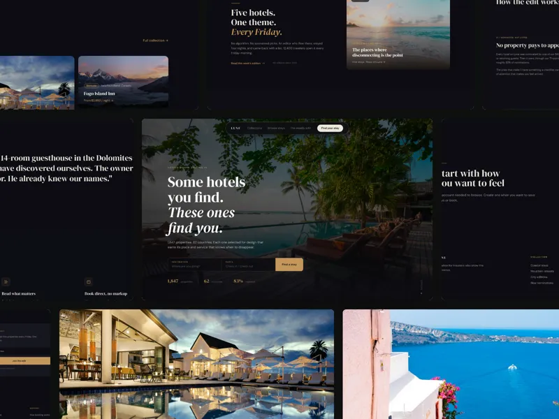 | 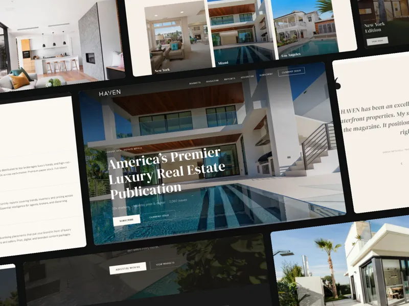 |
| `cascade` | `overview-grid` | `tilt` |

Every cover above is a real render from sites designed by the author.

### Every size, laid out again

| 1600 × 1200 · Dribbble, Contra | 1600 × 900 · slides, video | 1200 × 630 · link previews |
|---|---|---|
| 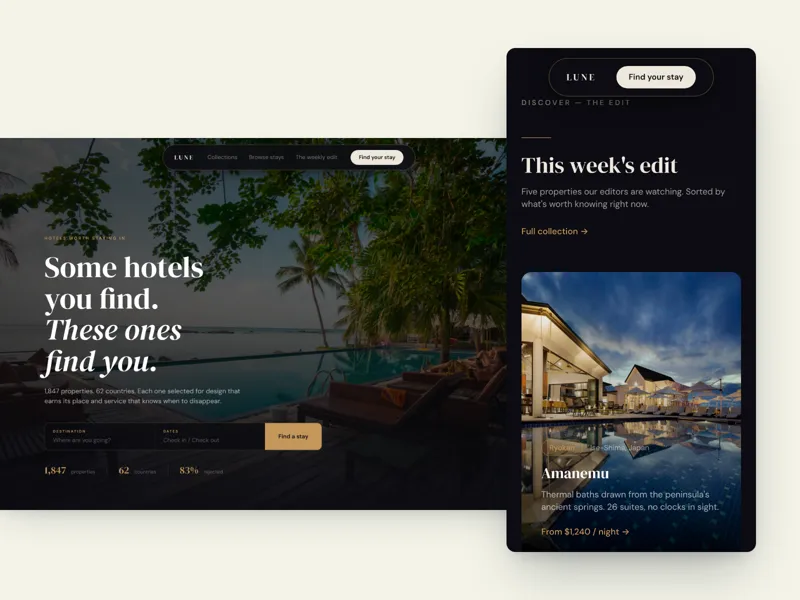 | 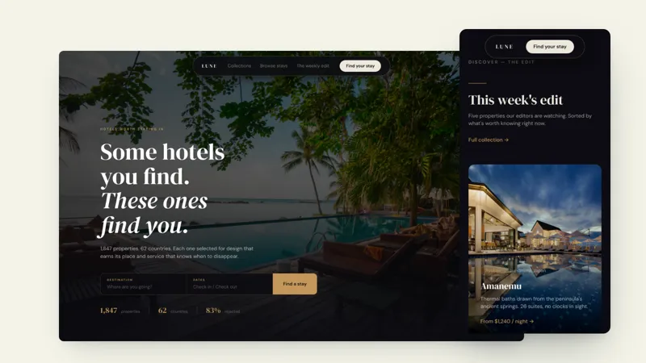 | 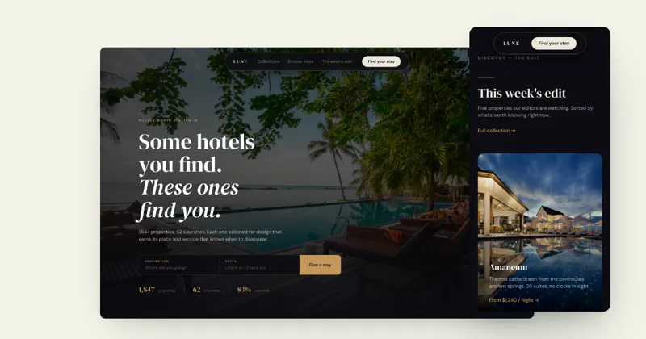 |

Each size is composed for its own canvas. Nothing is cropped or squeezed.

### Any ground, light or dark

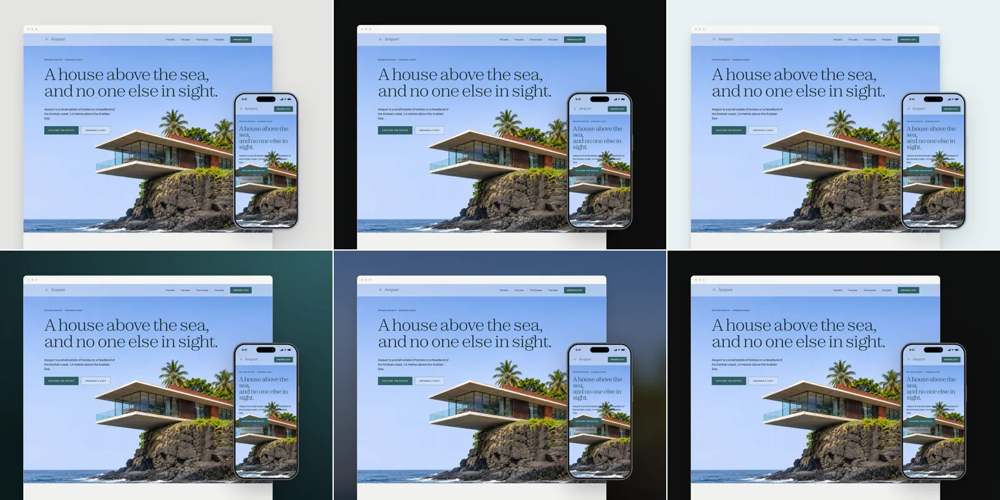

Eleven ground types (flat colour, gradients, tints from your accent, your own photos and more), plus grid, dot, line, ring or SVG overlays. Light or dark captures, light or dark frames.

## Features

- **Real captures.** Desktop at 2x, phones at their true viewports, light and dark, components, photographs and the site's logo. Scroll reveals are played through first, and full pages are stitched from real screens.
- **18 patterns**, each measured from a reference cover and built in proportions of the canvas.
- **Real devices.** Browser, MacBook Pro, iPad Pro, iPhone 17, iPhone 18 Pro, Pixel 10 and Galaxy S25, each with its own system UI.
- **Grounds from your own colours.** Solid, gradients, tint, mesh, photo and more, with optional patterns.
- **No text by default.** Covers carry no type or logo unless you turn branding on.
- **Local and free.** Runs on your machine. No account, no API key, no server.

## Quick start

Needs Node 20 or later and Chrome. If Chrome is not installed, run `npx playwright install chromium`, or point `CHROME_PATH` at a Chrome binary.

```bash
git clone https://github.com/rx4u/cover-studio
cd cover-studio
npm install

npm run cover -- init my-site               # writes cover.config.ts
# edit cover.config.ts: set source.url and source.pages
npm run cover -- render cover.config.ts     # captures, then renders
```

Covers are written to `covers/<name>/` as `<name>-<n>-<pattern>-<size>.png`. Captures are cached in `.cover-cache/<name>/`; pass `--fresh` to capture again.

## Use with an AI agent

Claude Code, Codex, Cursor or any agent with a shell can run cover-studio for you. Point it at [AGENTS.md](AGENTS.md): it has the setup, a post-pack config, which pattern fits which job, and the rules.

## Commands

| Command | What it does |
|---|---|
| `init [name]` | Write a starter `cover.config.ts` |
| `validate <config>` | Check a config and print every resolved value |
| `capture <config> [--fresh]` | Capture the site into the cache |
| `render <config> [--pattern <id>] [--fresh]` | Capture if needed, then render every pattern and size |

## Config

```ts
export default {
  name: "my-site",
  extends: "neutral-light",                       // or neutral-dark, or your own preset
  source: {
    url: "https://example.com",
    pages: ["/", "/about"],
    mobile: true,                                 // phone captures (on by default)
    colorScheme: "both",                          // light, dark or both
    logo: "header .logo",                         // for brand-split
    elements: [".pricing", ".signup"],            // components for macro, breakout, ui-bento
  },
  patterns: ["bento", "floating", "cascade"],     // the first one is the cover
  ground: { type: "tint" },
  frame: { device: "macbook-pro" },
  phone: { mix: true },
  export: { sizes: ["1600x1200", "1600x900", "1200x630"] },
};
```

Full reference: [docs/config.md](docs/config.md).

## Patterns

| Pattern | What it shows | Needs |
|---|---|---|
| `full-bleed` | The first screen in a frame, running off the bottom | a page |
| `lead-peek` | The lead page with a peek that opens on a section | a page |
| `photo-ground` | The page on the site's own photograph | `source.photo` |
| `strips` | Top, middle and end of the page in three columns | a page |
| `strips-brand` | Strips on the brand colour | a page |
| `macro` | One real component, whole, at poster scale | `source.elements` |
| `page-phone` | Browser, MacBook or iPad page with the phone in front | `source.mobile` |
| `phone-trio` | Three phones, level or raised, mixed models | `source.mobile` |
| `bento` | Hero, phone, photos and a component on one grid | a page; phones, photos and components when captured |
| `cascade` | Three sections layered, the most visual in front | a page |
| `floating` | Phone and desktop as one overlapping group | `source.mobile` |
| `breakout` | Real components lifted out of the page | `source.elements` |
| `ui-bento` | Justified rows of real components | 2+ `source.elements` |
| `brand-split` | The page beside its own logo and photo | `source.logo` |
| `editorial` | A lead column and two sections, larger | a page with 2+ sections |
| `overview-grid` | The whole site as a staggered mosaic | a page |
| `before-after` | Current site and new design at the same scale | `source.before` |
| `tilt` | The mosaic, turned and leaning back | a page |

Measurements and rules for each: [docs/patterns.md](docs/patterns.md).

## Presets

A preset is a JSON file with any part of the config. Keep one in `presets/` or next to your config and point `extends` at it, to hold one look per brand or portfolio.

## Known limits

- Pages behind a login, or ones that block headless browsers, will not capture.
- Very short pages give the mosaic patterns fewer sections to work with.

## Credits

- Grounds: [paper-design/shaders](https://github.com/paper-design/shaders), Apache 2.0.
- Device frames: [react-mockframe](https://github.com/mbdev3/react-mockframe) by Mohammed Banani, MIT. The CSS is vendored in `vendor/react-mockframe/` and its markup pre-rendered to `src/devices.generated.json`, so no React is needed.
- Status bar glyphs: [device-bars](https://github.com/SimonGolms/device-bars) by Simon Golms, MIT, using [Ionicons](https://github.com/ionic-team/ionicons) (MIT) and Google's [Material Icons](https://github.com/google/material-design-icons) (Apache 2.0).

## Author

Designed and built by **Raja**. [Portfolio](https://rajaraman.vercel.app/) · [Dribbble](https://dribbble.com/raja-raman) · [X](https://x.com/1bsfraja)

For freelance design and build work, [hire me on Contra](https://contra.com/siraguhq).

## Licence

[MIT](LICENSE)
